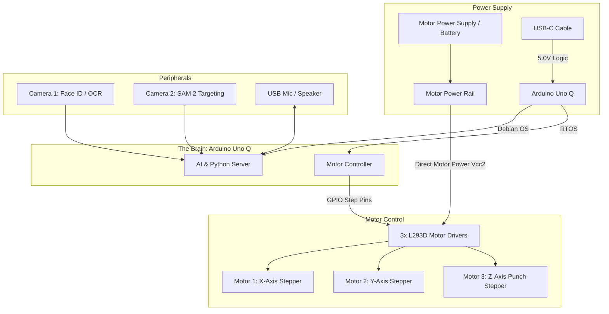
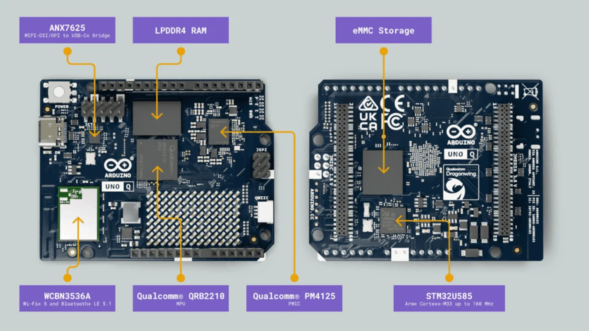
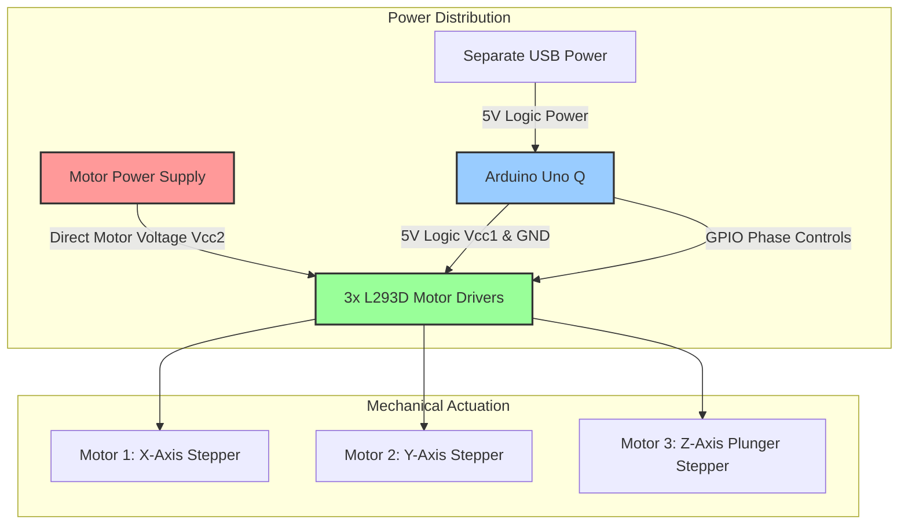
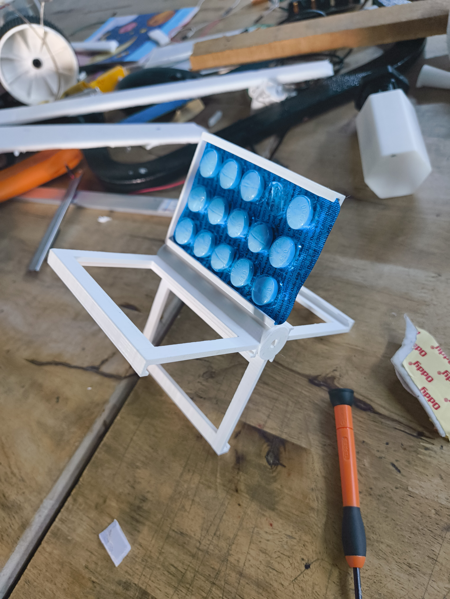
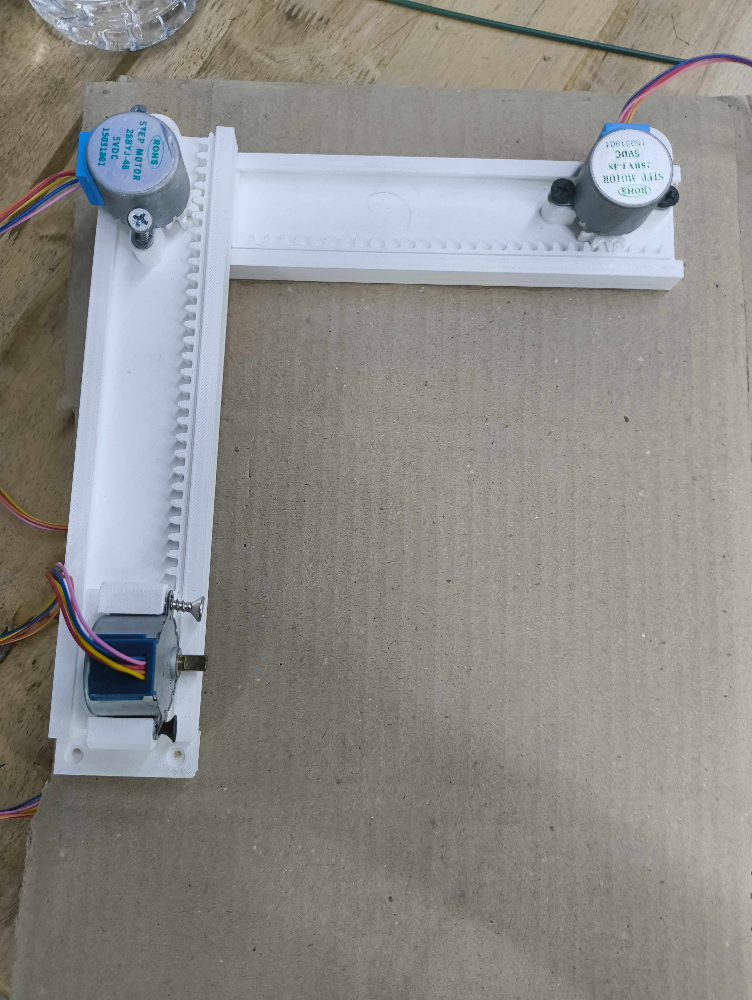
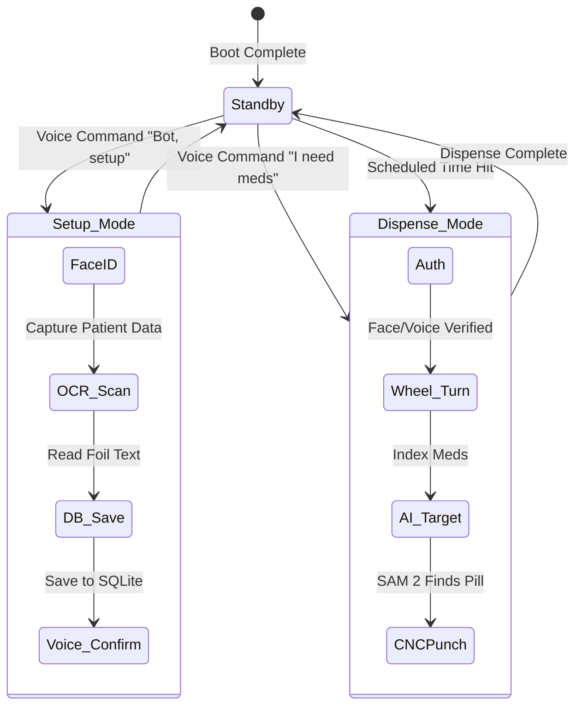
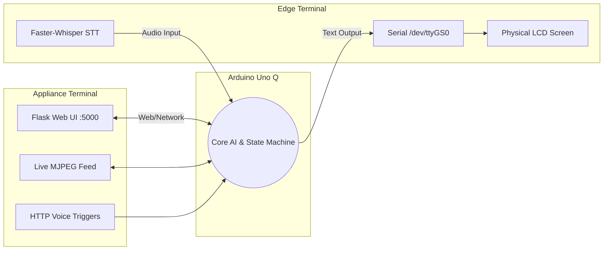
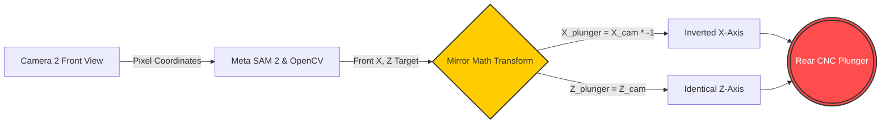
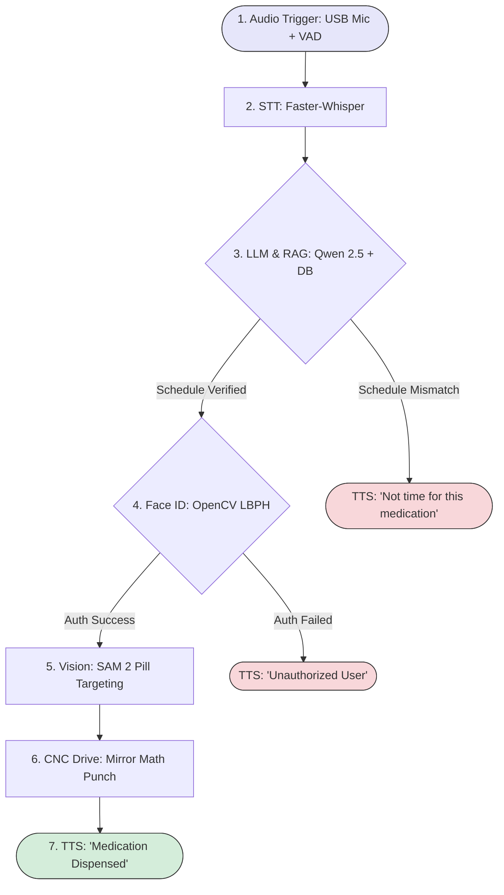

# Blister Bot 💊🤖: DIY Edge AI Automated Medicine Dispenser

We can see automated medicine dispensers ranging from simple timed plastic boxes to massive pharmacy robotics. When we generally talk about home dispensers, they usually require the user to manually pop out pills and load them into daily bins. But what if a robot could handle the original packaging directly?

In this project, we challenge ourselves to build a complex mechatronic system that combines rotational indexing with a Cartesian CNC movement to mechanically punch pills right out of their original foil blister packs. Instead of relying on cloud APIs, this robot is powered entirely by Local Edge AI to ensure patient privacy (HIPAA compliance), offline reliability, and low-latency mechanical targeting.

If you're wondering how to make a smart, AI-driven pill dispenser at home using an Arduino Uno Q, this build walks through the full process, from CNC kinematics to the conversational code.

---

## 💡 Motivation
What if you didn't have to manually strip pills from medicine packets every time you had a cold? What if elderly people in nursing homes and living alone at home could be safely monitored and assisted even when there is no one around? And what if all of this was hands-free and handled by speaking as if you were talking to a regular person—and to top it off, all offline, so your private talks remain strictly within your circle?

That's what the Blister Bot is all about.

Not only has AI become more capable, it has also become vastly more efficient. Now, small models that can run on an old laptop with no dedicated GPU can handle complex tasks including conversational chatbots, coding, character recognition, speech-to-text, and facial recognition. All of this opens up the possibilities of creating useful, intelligent devices without needing an internet connection.

Historically, the only limitation was lightweight, powerful, and cheap hardware. We were stuck using TinyML on classic boards like the ESP32 or Arduino Uno R4, which are ultimately just microcontrollers lacking the raw memory to hold complex workflows. Luckily, with the creation of the Arduino Uno Q and similar boards, we finally have the edge hardware to pull off these AI hardware projects without compromise.

---

## 🤖 What is the Blister Bot?
The Blister Bot is a prototype DIY automated medicine dispenser designed to securely manage, schedule, and dispense medication directly from standard foil/plastic blister packs. Unlike traditional automatic dispensers where you must manually extract each pill to load the machine, the Blister Bot takes the entire untouched blister pack. It utilizes a custom-built 3-axis mini CNC machine to scan, target, and plunge or contour-drill the pill out of its casing. 

Furthermore, the Blister Bot acts as an intelligent medical assistant. It features a fully conversational AI interface, allowing patients to simply talk to it. Before dispensing any medication, it uses facial recognition to authenticate the user, cross-referencing their identity with an internal SQLite database to prevent overdosing or dispensing to the wrong patient. All of this runs entirely offline on edge hardware.

---

## ✨ Key Advantages
* **Zero Prep Work:** Dispenses directly from original blister packs using a CNC punch, eliminating the tedious need to pre-sort pills into weekly bins.
* **100% Offline AI:** Uses miniaturized, local AI models (like Qwen 0.5B, Sherpa-ONNX, and Piper) to ensure medical data privacy and zero latency. Absolutely no internet connection is required.
* **Conversational Interface:** Talk to it naturally instead of navigating a complex touchscreen, app, or confusing buttons.
* **Biometric Security:** Prevents accidental or unauthorized overdoses by physically verifying the patient's face before cutting the foil.
* **Dual Monitoring Interfaces:** Both a physical Edge LCD terminal and an Appliance Flask Web UI for caregivers.
* **Clinical Health Tracking:** Automatically logs patient pain complaints and medication events to persistent timestamped records.

---

## 🧰 Components Required

| Parts Used | How Many Units Required | Purpose |
| :--- | :---: | :--- |
| **Arduino Uno Q** | 1 | The main brain. The quad-core Qualcomm side handles AI and web serving, while the ARM Cortex RTOS handles real-time motor control. |
| **L293D Motor Drivers** | 3 | 3 dedicated dual H-bridge motor drivers (1 driver per motor) providing direct bidirectional drive for the 3 stepper motors without needing a buck converter. |
| **28BYJ-48 Stepper Motors** | 3 | Controls the 3 physical axes of the CNC gantry (X-axis, Y-axis, and Z-axis plunger). |
| **USB Webcams** | 2 | Camera 1 is for patient Facial Recognition & OCR. Camera 2 is for Pill Contour Detection. |
| **Motor Power Supply / Battery Pack** | 1 | Dedicated power supply routed directly to the L293D motor supply pins (Vcc2). |
| **Custom 3D Printed Parts** | 1 Set | Includes the `blissupport.stl` framing, CNC gantry, and the `medicinewheelstand.stl` rotary wheel. |

---

## ⚡ System Architecture



The Blister Bot relies on a highly integrated architecture split between logical AI processing and real-time physical actuation:

1. **Conversational LLM Interface 🗣️:**
   When you approach the machine, it utilizes a local **Qwen 2.5 LLM (0.5 Billion parameters)** for reasoning.
   * **Listening:** Uses **Sherpa-ONNX** (fine-tuned on custom voice data) for fast, offline speech-to-text.
   * **Processing:** Evaluates commands against an internal SQLite medical schedule and ruleset.
   * **Speaking:** Replies verbally using **Piper** for high-quality text-to-speech.

2. **Facial Recognition Security 👤:**
   To prevent unauthorized dispensing, the system requires biometric authentication.
   * Your medical profile is securely stored using an **LBPH (Local Binary Pattern Histogram)** face recognizer.
   * Authentication must pass before the physical CNC actuates.

3. **Automated Pill Extraction ⚙️:**
   * Camera 2 takes a snapshot of the blister pack.
   * **OpenCV contour detection** and **Meta's SAM 2 (Segment Anything Model 2)** locate the exact boundaries of the pill.
   * The software calculates a "Mirror Math" coordinate transformation.

---

### 🧠 The Single-Board Computer: Arduino Uno Q Breakdown



The system bypasses the traditional "Raspberry Pi + separate Arduino" dual-board combo by utilizing the **Arduino Uno Q**, a hybrid Single-Board Computer (SBC) featuring an asymmetric multi-processing architecture:
* **The AI Brain (Linux Host):** Powered by a Qualcomm Dragonwing QRB2210 (Quad-core Arm Cortex-A53 @ 2.0 GHz) with an Adreno GPU and 4GB of LPDDR4 RAM. It runs Debian Linux, hosting the Python Flask server, SQLite databases, computer vision models, and heavy AI inference runtimes.
* **The Motor Brawn (Real-Time MCU):** An integrated ST STM32U585 (Arm Cortex-M33) handles deterministic, low-level GPIO timing and pulse-generation for stepper motors without Linux kernel scheduling jitter.
* **Linux-to-MCU Motion Bridge:** Coordinated over an internal TCP socket bridge (`127.0.0.1:7500`) for motion commands (`X <steps>`, `ACK:X`) and a serial UART bridge (`/dev/ttyGS0` @ 115200 baud) for the physical LCD screen.

---

## 🔌 Circuit Diagram & Firmware Pinouts



### Power Isolation & Direct L293D Driver Architecture
Instead of using an external LM2596 buck converter, the machine uses **three dedicated L293D dual H-bridge motor drivers** (1 driver per stepper motor):
* **Direct Motor Driving:** Motor power connects directly to the motor supply voltage pins (`Vcc2` / `Vs`) of each L293D driver IC, providing clean power directly to the 3 stepper motors without requiring a buck converter.
* **Logic Separation:** The logic supply pins (`Vcc1` / `Vss`) and control inputs are driven safely by the 5.0V rail and GPIOs of the Arduino Uno Q.
* **Common Ground & Inductive Isolation:** Grounds are tied together to maintain a common logic reference while internal clamp diodes in the L293D suppress inductive motor flyback spikes, keeping the microprocessor safe.

### Firmware Pinout & Stepper Control (`cnc_plotter.ino`)

The firmware on the STM32 microcontroller side implements an 8-step half-stepping sequence (`stepMatrix[8][4]`) with a 2ms phase delay to maximize holding torque and eliminate skipped steps across the 3 motors:

| Motor Axis | Microcontroller Digital Pins | Driver Board | Function |
| :--- | :--- | :--- | :--- |
| **X-Axis** | Pins `2, 3, 4, 5` | L293D Driver #1 | Horizontal gantry traverse |
| **Y-Axis** | Pins `6, 7, 8, 9` | L293D Driver #2 | Vertical gantry height traverse |
| **Z-Axis** | Pins `10, 11, 12, 13` | L293D Driver #3 | Foil plunger / contour drill punch |

**Thermal Protection (`powerDown()`):** After every coordinated axis movement, all four phase pins on the active axis are immediately driven `LOW`. This eliminates continuous holding current during idle periods, preventing stepper coils from overheating and conserving battery power.

---

## 📐 3D Printing & Mechanical Design

The mechanical chassis is built around a dual-sided "sandwich" structure: Camera 2 inspects the front plastic bubbles, while the 3-axis CNC gantry attacks from the rear foil backing.

### 1. The Rotary Medicine Wheel & "Universal Pocket"



Instead of 3D printing custom plastic slots for hundreds of different pill blister geometries, the system uses a 4-blade rotary indexing rotor modeled programmatically using **Zoo's KittyCAD Language (KCL)** in `cad/main.kcl`:
* **Blade Dimensions:** 4 blades at 90° intervals, 95 mm blade length parallel to the central hub, 3 mm base thickness.
* **The "Universal Pocket":** Total outer blade width is 68 mm, accommodating a **64 mm inner blister pack bay** (`packetWidth = 64mm`) bounded by two 2 mm vertical walls.
* **Aperture Window:** A centered **50 mm × 80 mm through-cut cutout** through the base plate leaves 7.5 mm flush end borders.
* **Retention Channels:** Inward-facing channels with 2 mm retaining lips and 3.5 mm vertical clearance hold the rigid foil perimeter of the blister pack, suspending the plastic bubbles over the empty 50 × 80 mm void.
* **Hub Coupling:** Central hub of Ø20 mm × 97 mm with a blind D-shaft socket (nominal Ø5 mm truncated at 1.5 mm, 4 mm flat-to-curve, 12 mm depth) custom-fit to the 28BYJ-48 stepper motor shaft.

### 2. The 3-Axis Cartesian CNC Gantry Prototype



The CNC gantry operates entirely on the rear foil side of the blister pack:
* **Dual Linear Y-Rails:** Driven by the Y-axis stepper motor along the guide rails. It features a custom 3D-printed Perpendicular L-Bracket Hard Stop to arrest overtravel.
* **X-Axis Traverse:** Slides horizontally along the gantry cross-beam to position the toolhead.
* **Z-Axis Plunger & Drill Tool:** Punctures the foil backing. Software controls both direct plunging and coordinated X/Y contour-tracing to cut around the perimeter of the blister.
* **Chassis Frame (`blissupport.stl`):** Houses the cameras at fixed focal lengths to ensure OpenCV contour mathematics remain consistent.

### 3. Rapid Prototyping Realities: The "Trash-Bot" Pivot

Building high-precision mechatronics using low-cost geared steppers and desktop 3D prints introduces real-world physical hurdles:
* **Axis Binding & Torque Limits:** 3D prints flex under side loads, and small geared stepper motors have modest torque.
* **The "Flat-Bed Hack" (MVP Triage):** To decouple mechanical troubleshooting from AI software validation, the rotary wheel can be temporarily detached and blister packs taped flat to the base chassis ("Flat-Bed Hack").
* **Frame Reinforcement:** Cardboard gussets, hot glue, and triangular brace structures were used during initial testing to stiffen the 3D-printed frame, allowing the entire vision-to-motor coordinate loop to be fully verified before locking in final mechanical parts.

---

## 💻 Deep Dive: Core AI Capabilities & Software Modules

Because the machine runs offline, memory management on the Uno Q is critical. The state machine (`master_controller.py`) orchestrates loading and unloading AI models dynamically so we don't run out of RAM.



> **Toolchain Note:** **Zoo (Zoo.dev / KCL)** is used exclusively for programmatic 3D CAD modeling (`cad/main.kcl`). Model compilation and hardware optimization for the Qualcomm Dragonwing architecture is handled via **Qualcomm AI Hub (`qai_hub`)** (`compile_qwen_aihub.py`), tracing PyTorch models into LiteRT / TFLite (`qwen_optimized.tflite`).

### 1. Dual Interface System



The bot provides two main ways to interact, designed for both patients and caregivers:
* **Appliance Terminal:** A Flask web UI running on port 5000 that allows caregivers to view the live MJPEG camera feed with targeting crosshairs, monitor system logs, trigger HTTP voice commands, and manually jog X, Y, and Z axes via `/api/move`.
* **Edge Terminal:** A lightweight serial-based interface (`main_edge_terminal.py`) that uses `faster-whisper` for ultra-low latency STT and outputs the AI's responses to a physical LCD screen via a serial bridge connected to the microcontroller's UART port (`/dev/ttyGS0`).

### 2. Fast Audio Processing & Custom Fine-Tuning Pipeline

The voice pipeline is heavily optimized for the embedded CPU of the Arduino Uno Q:
* **Sherpa-ONNX Streaming Zipformer:** Runs an INT8-quantized Indian English streaming Zipformer model (`OnlineRecognizer.from_transducer`, 80 feature dimensions, 16 kHz sample rate).
* **Hardware Resampling & DC Filtering:** Audio is captured via ALSA hardware resampling (`plughw:0,0`) at 16000Hz. Software applies DC offset removal (`chunk - np.mean(chunk)`) and a digital gain multiplier (`MIC_GAIN = 2.5`) to eliminate Whisper hallucinations.
* **Custom STT Dataset & Fine-Tuning Pipeline (`code/stt_dataset_collector`):**
  * **Dataset Collector Web UI (Port 5001):** Collected 91 custom medical audio samples with corresponding transcripts.
  * **PyTorch Icefall Training:** Uses `lhotse` manifests (`custom_corpus`) and runs 10 epochs of FP16 fine-tuning (`finetune.sh`) on a pre-trained PyTorch checkpoint (`pretrained.pt`).
  * **ONNX Export:** Exports fine-tuned weights back to INT8 ONNX graphs (`encoder`, `decoder`, `joiner`) for execution on the Uno Q.
  * **Parallel Whisper Benchmarking (Port 5002):** A companion tester running `sherpa-onnx-whisper-tiny.en` to benchmark Word Error Rates (WER) against the custom Zipformer.
* **Edge-TTS & Piper:** For speech synthesis, Piper ONNX (`en_US-lessac-low.onnx`) directly synthesizes 16 kHz audio played via Python `sounddevice`, while Edge-TTS runs as an alternate engine via `ffplay`.

### 3. Intelligent Medicine Scanner & RAG
* **Medicine Scanner (OCR):** Combines `rapidocr-onnxruntime` and `pytesseract` to continuously monitor the camera feed, extract text from reflective curved medicine packets, and announce names aloud.
* **Retrieval-Augmented Generation (RAG):** When you ask for medication, the Qwen LLM queries an internal `medical_database.json` to verify schedules, dosages, and interactions (such as whether Ibuprofen requires food) before dispensing.

### 4. Facial Recognition & Security
* We utilize the **LBPH (Local Binary Pattern Histogram)** recognizer from `opencv-contrib-python-headless` paired with `haarcascade_frontalface_default.xml`.
* During setup, it captures 10 training frames per user, trains on-device, and stores weights in `face_model.yml` linked to SQLite profile IDs (`attendance.db`).
* Every dispense event and interaction is strictly logged to prevent unauthorized access.

### 5. Mirror Math Kinematics & SAM 2 Vision

Locating the pill is a complex physical-to-digital translation problem. By looking at the clear plastic bubbles on the front of the packet, Camera 2 takes a snapshot. We use **Meta's Segment Anything Model 2 (SAM 2)** combined with OpenCV to accurately detect the boundaries of the blister. 

The Python script applies a scaling factor to convert pixels to millimeters, and then applies a **Mirror Math** formula to tell the rear-mounted CNC plunger exactly where to strike on the back of the packet:

```python
# The camera looks at the front, but the CNC punch attacks from the rear.
# The X-axis must be inverted for perfect alignment.
X_plunger = X_cam * -1
```



**Contour Tracing vs Single Plunge (`test_drill.py`):** In addition to center-point strikes, the kinematics engine calculates pixel offsets relative to optical center `(cx, cy)` using `PIXEL_TO_STEP_RATIO = 1.0`. The gantry plunges (`Z 2`), steps through the pill boundary contour points with a `0.05s` drag delay, and retracts (`Z -2`) to cleanly cut around the foil.

### 6. The Full AI Pipeline & 10-Class Intent Classification



1. **Audio Trigger:** Captured via USB mic (filtered by Voice Activity Detection).
2. **STT:** Transcribes audio to text offline using Sherpa-ONNX or Faster-Whisper.
3. **LLM Intent Classification:** Qwen 2.5 classifies commands into 10 structured categories:
   * `ADD_PATIENT`: Voice intake of patient metadata and 10-frame face registration.
   * `DRILL_MEDICINE`: Targets medicine, verifies identity, indexes wheel, and executes CNC extraction.
   * `PATIENT_DETAILS`: Queries and speaks patient clinical information.
   * `UPDATE_PATIENT`: Voice-driven updates to existing patient records.
   * `DOSAGE_QUERY`: RAG query against `medical_database.json` and inventory.
   * `SCHEDULE_QUERY`: Checks schedule against requested medicines.
   * `MEDICINE_QUERY`: Explains drug indications, mechanisms, or precautions.
   * `PAIN_REPORT`: Detects discomfort reports (e.g. *"I have a headache"*), provides empathetic voice advice, and automatically appends a timestamped log to `code/painrec/<patient_name>.md`.
   * `CONVERSATION`: Friendly, casual interaction.
   * `Q_AND_A`: General medical assistant fallback.
4. **Face ID:** Verifies user identity against `attendance.db` via OpenCV LBPH.
5. **Vision:** Targets the pill boundaries using SAM 2 and geometric ellipse scoring.
6. **CNC Drive:** Pulses stepper motors using Mirror Math and contour drilling.
7. **TTS:** Announces verbal status (*"Your medication is dispensed"*) and decrements inventory.

---

## 🗄️ Database Schema & Clinical Health Logging

### 1. SQLite Relational Schema (`attendance.db`)

```sql
CREATE TABLE IF NOT EXISTS caretakers (
    id INTEGER PRIMARY KEY AUTOINCREMENT,
    name TEXT NOT NULL,
    work_shift TEXT,
    is_patient BOOLEAN,
    face_path TEXT
);

CREATE TABLE IF NOT EXISTS patients (
    id INTEGER PRIMARY KEY AUTOINCREMENT,
    name TEXT NOT NULL,
    age INTEGER,
    gender TEXT,
    health_issues TEXT,
    med_schedule TEXT,
    assigned_caretaker_id INTEGER,
    face_path TEXT,
    FOREIGN KEY(assigned_caretaker_id) REFERENCES caretakers(id)
);

CREATE TABLE IF NOT EXISTS inventory (
    id INTEGER PRIMARY KEY AUTOINCREMENT,
    med_name TEXT NOT NULL,
    dosage TEXT,
    slot_index INTEGER,
    med_count INTEGER
);
```

### 2. Clinical Pain & Medication Event Logs (`code/painrec/`)

Patient pain reports and dispensing events are persistently recorded in human-readable Markdown logs (`code/painrec/<patient_name>.md`):
```markdown
## Pain Report: 2026-10-11 14:22:10
- **Patient Details**: {'name': 'John Doe', 'age': 72, 'health_issues': 'Hypertension'}
- **Report**: I am feeling sharp pain in my lower back

## Medication Event: 2026-10-11 14:25:30
- **Medicine**: Paracetamol
- **Status**: TAKEN
```

---

## 🛠 Setup & Installation Guide

### Prerequisites
Make sure your Arduino Uno Q is running its Debian Linux image and is connected to Wi-Fi for the initial download phase:
```bash
sudo apt update
sudo apt install python3-pip python3-opencv ffmpeg portaudio19-dev libasound-dev
```

### Model & Package Installations
Install the Edge AI runtimes required for the system:
```bash
pip3 install faster-whisper edge-tts rapidocr-onnxruntime Flask pyserial sounddevice llama-cpp-python sherpa-onnx piper-tts
pip3 install git+https://github.com/facebookresearch/sam2.git
```

### Flashing the Real-Time OS Firmware
Compile and flash `code/stepper_motor_controller/cnc_plotter.ino` to the STM32 Cortex-M33 side of the board so that it can receive instructions over the socket bridge from `master_controller.py`.

---

## ⚙️ System Daemon & Deployment

To ensure the Blister Bot automatically starts on boot, register `blisterbot.service` with `systemd`:

```ini
[Unit]
Description=Blister Bot Master Controller
After=network.target sound.target

[Service]
Type=simple
User=arduino
WorkingDirectory=/home/arduino/Blister-bot-main-/code
ExecStart=/usr/bin/python3 /home/arduino/Blister-bot-main-/code/master_controller.py
Restart=always
RestartSec=5

[Install]
WantedBy=multi-user.target
```

Enable and start the service:
```bash
sudo cp blisterbot.service /etc/systemd/system/
sudo systemctl daemon-reload
sudo systemctl enable blisterbot.service
sudo systemctl start blisterbot.service
```

---

## 📁 Repository Structure

```text
📦 Blister-bot-main-
 ┣ 📂 appliance_terminal/          # Flask Web UI (port 5000), OCR scanner & manual axis jogging
 ┣ 📂 edge_terminal/               # Serial LCD interface (/dev/ttyGS0) & faster-whisper STT
 ┣ 📂 assets/                      # Hardware images, prototype photos, and demo video
 ┃ ┣ 🖼️ arduinoboardimage.webp    # Arduino Uno Q board breakdown
 ┃ ┣ 🖼️ cncprototype.jpg          # 3-axis CNC gantry prototype photo
 ┃ ┣ 🖼️ medholderphoto.jpg        # Rotary paddle medicine wheel photo
 ┃ ┣ 🎥 cncmovingtrial.mp4        # CNC physical movement test trial video
 ┃ ┗ 🖼️ sample_result.jpg         # SAM 2 pill segmentation output
 ┣ 📂 code/
 ┃ ┣ 📜 master_controller.py       # Main state machine, 10-class intent classifier & video server (port 9999)
 ┃ ┣ 📜 compile_qwen_aihub.py      # Qualcomm AI Hub export script for Dragonwing LiteRT models
 ┃ ┣ 📜 test_drill.py              # Contour-tracing & mirror math drill tests
 ┃ ┣ 📜 test_rag.py                # RAG evaluation against medical database
 ┃ ┣ 📜 test_stt.py                # STT benchmarking script
 ┃ ┣ 📜 medical_database.json      # RAG inventory and contraindication rules
 ┃ ┣ 📜 attendance.db              # SQLite database for caretakers, patients, and inventory
 ┃ ┣ 📂 UNO/                       # GGUF models (Qwen 0.5B), Piper TTS ONNX & Sherpa-ONNX streaming Zipformer
 ┃ ┣ 📂 blister_detector/          # Meta SAM 2 vision bounding box & ellipse scoring scripts
 ┃ ┣ 📂 facerecog-unoq/            # OpenCV LBPH face recognizer & Haar cascades
 ┃ ┣ 📂 painrec/                   # Clinical pain reports & medication intake markdown logs
 ┃ ┣ 📂 stepper_motor_controller/  # Arduino C++ firmware (cnc_plotter.ino) & local motor bridge (port 7500)
 ┃ ┣ 📂 stt_dataset_collector/     # STT dataset collector (port 5001), PyTorch icefall trainer & Whisper tester (port 5002)
 ┃ ┗ 📂 utils/                     # Video telemetry viewer (monitor_viewer.py) & sync scripts
 ┣ 📂 cad/                         # 3D printable STL files, Zoo KCL model (main.kcl) & design notes (NOTES.md)
 ┣ 📂 docs/                        # Complete Engineering Specification & progress logs
 ┃ ┗ 📜 blister_bot_complete_engineering_specification.md # Master engineering document
 ┣ 📂 scripts/                     # Automated deployment and rsync sync tools
 ┣ 📜 blisterbot.service           # Systemd unit file for headless boot
 ┗ 📜 README.md
```

---

## 🎯 Testing & Final Results

Got the cnc miller working and the facial recog and llm working.Tried to use a bluetooth speaker for the llm output but due to connectivity issues had to switch to an earphone.The cnc miller is able to move successfully,but while drilling,due to the hollow wheel and the fact that the medicine holder wasnt strongly glued or attached to the ground became unstable.

<video src="assets/cncmovingtrial.mp4" controls="controls" width="100%"></video>

*(If your browser does not support inline video playback, view or download the raw clip directly: [assets/cncmovingtrial.mp4](assets/cncmovingtrial.mp4))*

---

## 📝 Developer Reflections: Current Status & Lessons Learned

### current status and thoughts on the whole thing:
In the programs last week,i attempted to move from a cardboard DIY setup to a more formal 3d printed version.I had to 3d print the base,designed a custom medicine holder and had to find a way to make the wheel rotate and control its rotation.The drill that was supposed to make a hole in the packets was too short and I had to print the "chain and slide" thing again to increase its length,however  due to some issues with the software/scaling problems the new part came out wrong.The medicine holder also had a hole in it for a shaft piece,but the piece broke and  got stuck ,which kind of paused the project

### what i should have done:
The drill was the core part of the entire project,and instead of dedicating all my time to fixing it first,i spread my focus too thin and focused on several things at once,especially the ai work on the software side  which could have been done last

### Edge Segmentation & Vision
Edge segmentation models are pretty good now,and sam3 is especially good.If i remember correctly,i did not have to finetune it and just gave it one or two labelled examples and it was able to find the pill boundaries

### Speech Models & Fine-Tuning Lessons
Edge based text to speech models  still have a lot to improve,though they are capable.Their weakness was that they were really optimized for us speakers and couldnt always transcribe the audio properly.To fix this,i tried to create a mini dataset consisting of some audio clips of indian english speakers saying common medicines related phrases like "give me paracetamol" etc to finetune the model for my usecase,but as my dataset was tiny,it actually made the model worse.The initial learning rate that was set was also too high,causing the model to forget what it had already learned.I intend to continue this with a larger dataset and more appropriate hyperparameters to see if i can optimize this.

### Mechanical Design Observations & Planned Fixes
The medicine holder is hollow in the center,and this was a deliberate choice ,so that the camera could see the front of the medicine and guess where the pill boundaries were,however this made the drilling tricky,as applying too much force on the packet caused it to pop out of the medicine holder,so i intend to solve this  with a translucent but rigid cover in the front

the wheel of the medicine holder that was attached to the medicine stand did not rotate smoothly due to friction,and this would lead to low precision when switching between meds.I intend to explore ways to make the rotation smoother by exploring things like ball bearings to fix this issue

### Hardware & Resource Constraints
The uno q is a capable board,but it can only fit a few models at once in its 4gb ram,and so i haf to work on a logic that loaded models only at the time of need and released the ones that were not immediately relevant

---

## 🚀 Running the Bot

To start the Blister Bot system manually on the Arduino Uno Q:
```bash
cd code/
python3 master_controller.py
```

*Note: Alternatively, use `sudo systemctl start blisterbot.service` to run it as a background system service.*
